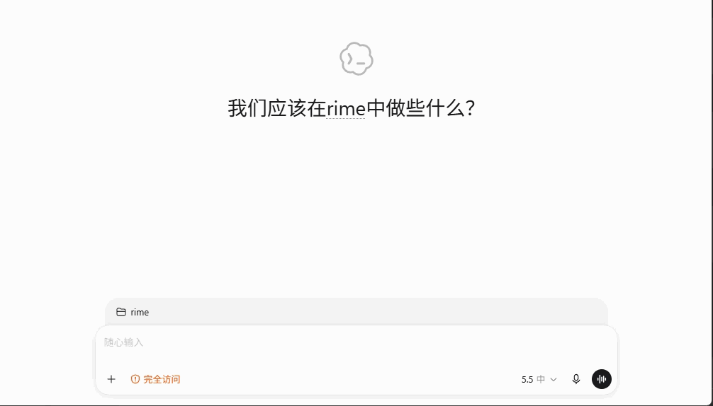
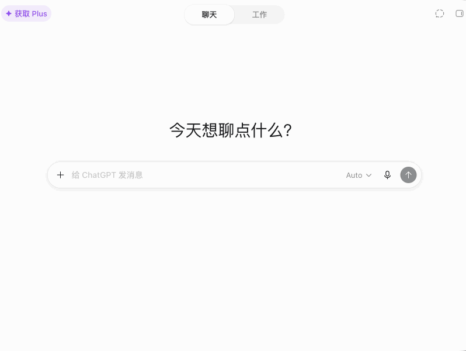

# text_polisher

类似 typeless 的全局 AI 文本润色与翻译工具，保留键盘输入习惯，通过快捷键优化选中文本，对静音办公更友好

text_polisher 不依赖语音输入，也不要求把内容复制到独立 AI 应用中处理。你只需要在当前应用里选中文本，按下快捷键，即可调用 AI 完成润色或翻译，并将结果原地替换回当前位置

目前项目包含两套实现：

- Windows：AutoHotkey v2 脚本
- macOS：Karabiner-Elements + Go 编译二进制

## 功能特性

- 全局快捷键触发，无需切换应用
- 支持润色选中文本
- 支持中英文自动翻译
- 支持 OpenAI-compatible 接口
- 支持 DeepSeek、千问、OpenCode Go 等 AI 供应商
- API Key 通过环境变量配置，避免写死在脚本中
- Windows 端适配 Windows Terminal、PowerShell、CMD、WSL Codex CLI 等输入场景
- macOS 端通过 Karabiner-Elements 触发 Go 工具，适合系统级快捷键工作流

## 快捷键

| 平台 | 润色 | 翻译 |
| --- | --- | --- |
| Windows | `Alt+Shift+1` | `Alt+Shift+2` |
| macOS | `Option+Shift+1` | `Option+Shift+2` |

## 效果演示

### Windows



### macOS



## 项目结构

```text
text_polisher/
├─ assets/
│  ├─ win_text_polisher.gif
│  └─ mac_text_polisher.gif
├─ windows/
│  └─ autohotkey/
│     └─ text_polisher.ahk
├─ macos/
│  ├─ karabiner/
│  │  └─ text_polisher.json
│  └─ text-polisher/
│     ├─ cmd/
│     ├─ internal/
│     ├─ go.mod
│     └─ text-polisher.sh
├─ LICENSE
└─ README.md
```

## Windows 使用方式

### 1. 安装 AutoHotkey v2

下载并安装 AutoHotkey v2：

```text
https://www.autohotkey.com/
```

### 2. 配置 API Key

推荐把 API Key 放到 Windows 用户环境变量中，不要写入脚本

```powershell
setx DEEPSEEK_API_KEY "你的 DeepSeek API Key"
setx DASHSCOPE_API_KEY "你的 DashScope API Key"
setx OPENCODE_API_KEY "你的 OpenCode Go API Key"
```

设置完成后，重新打开终端或重启 Windows 会话，让环境变量生效

### 3. 选择 AI 供应商

默认供应商可以直接在脚本中修改：

```autohotkey
DEFAULT_PROVIDER := "opencode_luna"
```

也可以通过环境变量覆盖：

```powershell
setx AI_TEXT_PROVIDER "deepseek"
setx AI_TEXT_PROVIDER "dashscope"
setx AI_TEXT_PROVIDER "opencode"
setx AI_TEXT_PROVIDER "opencode_luna"
```

### 4. 启动脚本

双击运行：

```text
windows/autohotkey/text_polisher.ahk
```

之后在任意可编辑区域中选中文本，按 `Alt+Shift+1` 润色，或按 `Alt+Shift+2` 翻译

## macOS 使用方式

### 1. 安装依赖

安装 Karabiner-Elements：

```text
https://karabiner-elements.pqrs.org/
```

安装 Go：

```text
https://go.dev/doc/install
```

### 2. 克隆到推荐目录

macOS 端的 Karabiner 规则默认使用下面这个路径：

```zsh
~/.config/text_polisher
```

推荐这样克隆：

```zsh
mkdir -p ~/.config
git clone https://github.com/echoiron/text_polisher.git ~/.config/text_polisher
```

如果克隆到其他目录，需要同步修改 text_polisher.json 中的 `shell_command` 路径

```text
macos/karabiner/text_polisher.json
```


### 3. 配置 API Key

推荐把 API Key 写入 `~/.zshrc` 或 `~/.zprofile`

```zsh
echo 'export OPENCODE_API_KEY="你的 OpenCode Go API Key"' >> ~/.zshrc
echo 'export AI_TEXT_API_KEY="$OPENCODE_API_KEY"' >> ~/.zshrc
source ~/.zshrc
```

macOS Go 工具支持 OpenAI-compatible 配置：

```zsh
export AI_TEXT_API_BASE_URL="https://opencode.ai/zen/go/v1"
export AI_TEXT_MODEL="gpt-5.6-luna"
export AI_TEXT_API_KEY="$OPENCODE_API_KEY"
```

也兼容旧变量：

```zsh
export OPENAI_COMPAT_BASE_URL="https://api.example.com/v1"
export OPENAI_COMPAT_MODEL="model-name"
export OPENCODE_API_KEY="sk-..."
```

### 4. 构建或首次自动构建

脚本 `macos/text-polisher/text-polisher.sh` 会在首次运行时自动构建二进制

也可以手动构建：

```zsh
cd ~/.config/text_polisher/macos/text-polisher
go mod tidy
go build -o bin/text-polisher ./cmd/text-polisher
```

### 5. 导入 Karabiner 规则

将下面的规则文件导入 Karabiner-Elements 的 Complex Modifications：

```text
macos/karabiner/text_polisher.json
```

常见做法是把该 JSON 复制到 Karabiner 的 assets 目录后再导入：

```zsh
mkdir -p ~/.config/karabiner/assets/complex_modifications
cp ~/.config/text_polisher/macos/karabiner/text_polisher.json ~/.config/karabiner/assets/complex_modifications/text_polisher.json
```

然后打开 Karabiner-Elements，在 `Complex Modifications` 中启用规则

### 6. 授权系统权限

在 macOS 中打开：

```text
System Settings -> Privacy & Security -> Accessibility
```

允许 Karabiner-Elements、Karabiner-EventViewer 或触发脚本的终端控制电脑。首次运行时如果复制、粘贴失败，通常是这里没有授权

## 配置项

### 通用 AI 配置

| 环境变量 | 说明 |
| --- | --- |
| `AI_TEXT_PROVIDER` | Windows 端供应商选择 |
| `AI_TEXT_API_BASE_URL` | macOS 端 OpenAI-compatible Base URL |
| `AI_TEXT_MODEL` | macOS 端模型名称 |
| `AI_TEXT_API_KEY` | macOS 端 API Key |
| `OPENAI_COMPAT_API_URL` | Windows 端自定义接口地址 |
| `OPENAI_COMPAT_MODEL` | Windows 端自定义模型 |
| `AI_TEXT_TRANSLATE_TARGET` | 翻译目标语言，支持 `auto`、`english`、`zh` |

### 代理配置

Windows 端默认使用本地手动代理：

```powershell
setx AI_TEXT_PROXY_MODE "manual"
setx AI_TEXT_PROXY_SERVER "http://127.0.0.1:1080"
```

可选值：

```text
manual
system
direct
```

macOS 端支持：

```zsh
export AI_TEXT_PROXY_MODE="system"
export AI_TEXT_PROXY_MODE="manual"
export AI_TEXT_PROXY_SERVER="http://127.0.0.1:1080"
export AI_TEXT_PROXY_MODE="direct"
```

## Windows Terminal 说明

Windows Terminal 的鼠标框选通常只是屏幕文本选择，不是普通文本框的可编辑选区。因此脚本在 Windows Terminal 中会先复制选中的屏幕文本，再按终端类型清理当前输入区域，最后粘贴 AI 返回结果，避免出现“原文 + 结果”拼接

Windows 端会根据活动窗口标题自动判断：

- 标题包含 `codex`、`ubuntu`、`wsl`：使用 WSL Codex 模式
- 标题符合 Linux shell 风格，例如 `root@DESKTOP-Q1RCCT1: ~`：使用 WSL Codex 模式
- 其他 Windows Terminal：使用普通行替换模式

## macOS 终端说明

macOS 端默认会复制选中文本、调用 AI、写入剪贴板，并在 Terminal、iTerm2、Warp 等终端中先清空当前输入再粘贴，避免结果直接拼接在原文后面

如果你在终端里只想复制结果，不想自动粘贴，可以设置：

```zsh
export AI_TEXT_MAC_TERMINAL_MODE="copy"
```

其他可选值：

```zsh
export AI_TEXT_MAC_TERMINAL_MODE="paste"
export AI_TEXT_MAC_TERMINAL_MODE="always_copy"
```

## 安全说明

请不要把 API Key 写死在脚本或源码中后上传到公开仓库。推荐使用 Windows 用户环境变量、macOS shell profile 或其他密钥管理方式保存密钥
